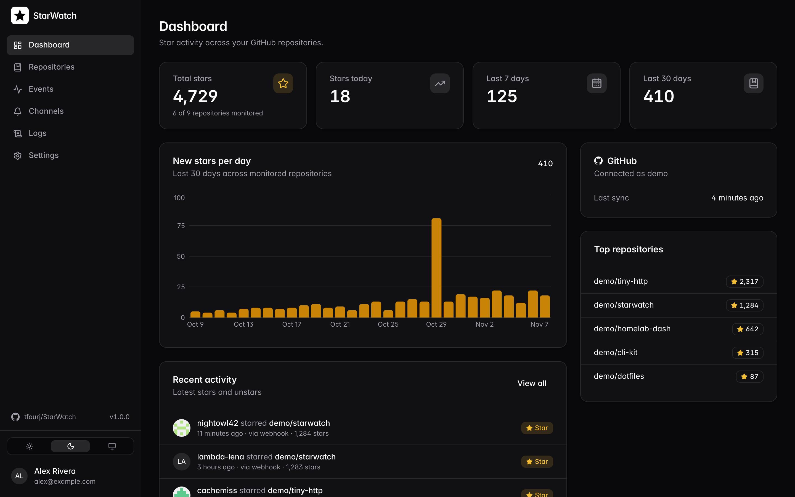
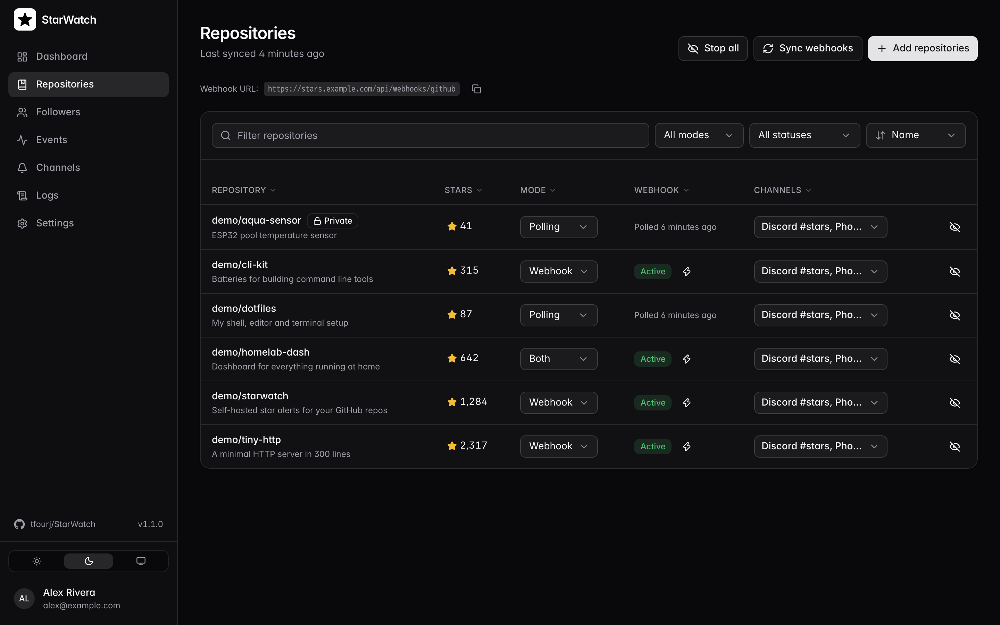
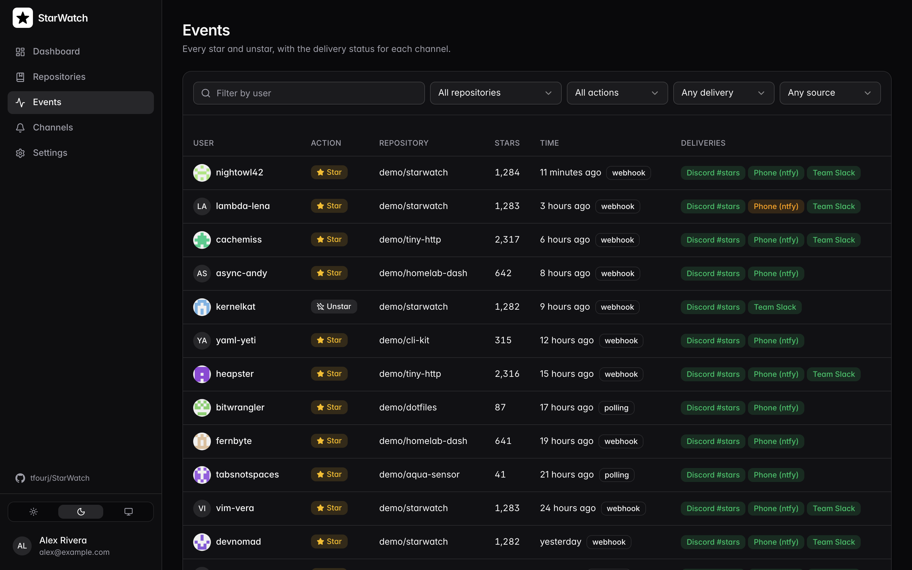
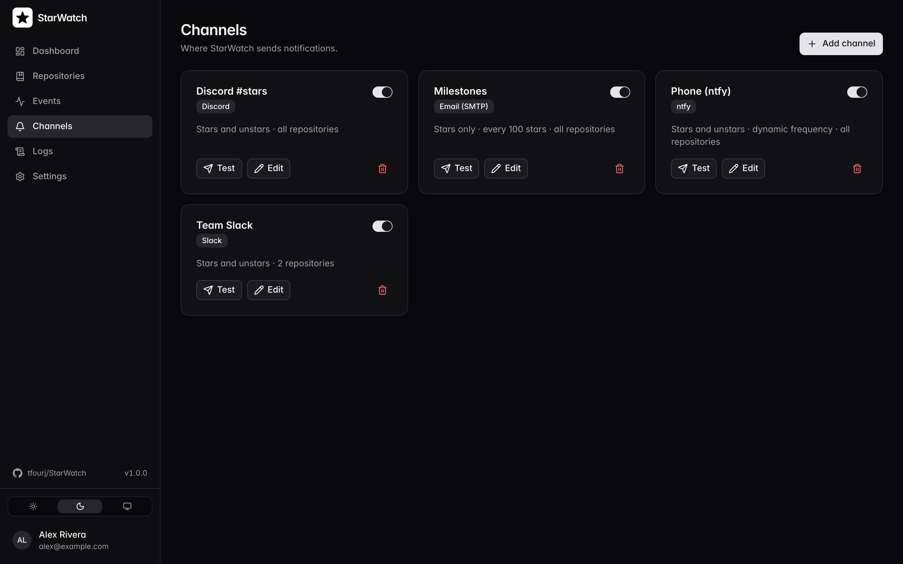

<p align="center">
  <picture>
    <source media="(prefers-color-scheme: dark)" srcset="docs/assets/logo-white.png">
    
  </picture>
</p>

<h1 align="center">StarWatch</h1>

<p align="center">
  Self-hosted star alerts for your GitHub repos.<br>
  Get notified when someone stars or unstars one of your repositories.
</p>

> [!NOTE]
> This app was developed using AI tools.

## Features

- Instant alerts through GitHub webhooks, with polling as a fallback
- Webhooks are created and repaired automatically
- Optional built-in Cloudflare Tunnel, so webhooks work without a reverse proxy
- Notifications for stars, unstars or only milestones (every 10, 100 ... stars)
- Follower tracking with alerts when someone follows or unfollows your GitHub account
- Custom message templates
- Dashboard with stats, chart and event log
- Two-factor authentication and login alerts on your channels
- Dark and light mode, multiple users
- Installable as an app (PWA)

## Screenshots

| Dashboard | Repositories |
| --- | --- |
|  |  |
| **Events** | **Channels** |
|  |  |

## Tech Stack

Bun, Hono, SQLite (Drizzle), Better Auth, React, Tailwind CSS

## Install with Docker Compose

1. Download [docker-compose.yml](docker-compose.yml).
2. Create a `.env` file next to it:

   ```bash
   # Public HTTPS URL, used for GitHub webhooks and login
   BASE_URL=https://starwatch.example.com

   # Generate each with: openssl rand -base64 32
   # Optional, generated into /data/secrets.json if empty. Never change ENCRYPTION_SECRET later.
   BETTER_AUTH_SECRET=
   ENCRYPTION_SECRET=

   # Optional
   PORT=4321
   # Default timezone, each user can change it in Settings → Account
   TZ=Europe/Berlin
   ALLOW_REGISTRATION=false
   GITHUB_CLIENT_ID=
   GITHUB_CLIENT_SECRET=
   ```

3. Start it:

   ```bash
   docker compose up -d
   ```

4. Open `BASE_URL` and create the first account. It becomes the admin.
5. In **Settings → GitHub**, add a classic token with `public_repo` (or `repo`) and `admin:repo_hook` scopes.

See [docs/CONFIGURATION.md](docs/CONFIGURATION.md) for all options and [docs/BUILD.md](docs/BUILD.md) to build from source.

## Notification providers

- Discord
- Telegram
- ntfy
- Gotify
- Slack
- Pushover
- Email (SMTP)
- Webhook (JSON)

## License

[GPL-3.0](LICENSE)
